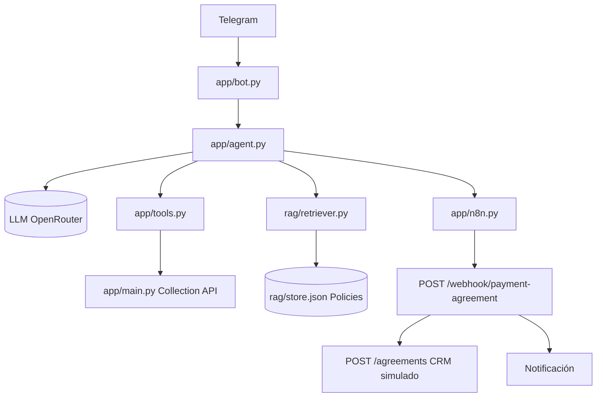

# Agente de cobranza (Python + Telegram + RAG + n8n)

Agente conversacional de cobranza: consulta deuda y planes por API,
responde políticas por RAG y confirma acuerdos vía webhook n8n.

## 1. Arquitectura



| Capa | Archivo | Rol |
|---|---|---|
| Bot | `app/bot.py` | polling, 1 sesión por `chat_id` |
| Agente | `app/agent.py` | loop function-calling, autorización en backend |
| Sesión | `app/session.py` | historial + `authenticated` + `pending_agreement` |
| REST | `app/tools.py` + `app/main.py` | datos transaccionales reales |
| RAG | `rag/` | solo políticas documentales |
| Actions | `app/n8n.py` + `n8n/` | acuerdo confirmado → webhook |

## 2. Cómo ejecutar el proyecto

```bash
python -m venv .venv && .venv\Scripts\activate
pip install -r requirements.txt
copy .env.example .env   # completa tus claves
```

## 3. Variables de entorno

| Var | Uso |
|---|---|
| `OPENROUTER_API_KEY` | LLM (nunca en código ni logs) |
| `COLLECTION_API_URL` | API cobranza (defecto `http://127.0.0.1:8000`) |
| `TELEGRAM_BOT_TOKEN` | bot Telegram (`123456:AAE-...` completo) |
| `N8N_WEBHOOK_URL` | webhook (defecto webhook local) |
| `N8N_WEBHOOK_SECRET` | secret compartido Python↔n8n (defecto `local-dev-secret`) |

## 4. Cómo ejecutar la API

```bash
uvicorn app.main:app
# GET /health, /customers, /customers/{id}/debt, /customers/{id}/payment-plans
# POST /agreements, POST /webhook/payment-agreement
```

## 5. Cómo ejecutar el agente

```bash
python -m app.bot      # Telegram (polling)
python app/agent.py    # consola (sesión "console", /empezar para cambiar persona)
```

## 6. Cómo ejecutar la ingestión del RAG

```bash
python -m rag.ingestion
# lee rag/documents/*.txt → chunks por regla → TF-IDF → rag/store.json
```

## 7. Cómo probar el RAG

```bash
python -m pytest tests/test_rag.py -v
python -m pytest tests/ -q   # todo (RAG + acuerdos)
```

Casos: 45 días→3 cuotas (RAG), ¿cuánto debo? (API), descuento máximo (RAG),
cliente 456 (auth+API), bitcoin (NO_INFO).

## 8. Cómo configurar n8n

1. n8n → Import from file → `n8n/workflow_payment_agreement.json`.
2. Copia la URL del nodo Webhook a `N8N_WEBHOOK_URL`.
3. Mismo `N8N_WEBHOOK_SECRET` en n8n y `.env`.
4. Detalle completo en `n8n/README.md`. Prueba local sin n8n con `curl` de ese README.

## 9. Ejemplos de conversaciones

```
Tú: Mi documento es 0912345678.
Agente: ¡Hola Juan! Confírmame tu nombre o teléfono.
Tú: Juan Pérez
Agente: Identidad validada. ¿Consultamos tu deuda o planes?
Tú: ¿Puedo pagar en 3 cuotas con 45 días de mora?
Agente: (RAG, cita politica_cobranza.txt) Sí, con 1-60 días puedes hasta 3 cuotas...
Tú: Quiero ese plan de 3
Agente: Son 3x 206.67. Responde "SI ACEPTO" para confirmar.
Tú: SI ACEPTO
Agente: Acuerdo 1001 confirmado y notificado. ✅
```

## 10. Diferencia entre API y RAG

* **API (`app/tools.py`)**: deuda, cliente, saldo, planes reales. Única fuente de verdad transaccional.
* **RAG (`rag/`)**: políticas, refinanciamiento, escalamiento, FAQs. Nunca devuelve montos ni sustituye a la API. Sin contexto → `NO_INFO`, no inventa. Cada respuesta cita `source + chunk_id + score`.

## 11. Decisiones de seguridad

* El LLM **no** autoriza: `get_my_debt`, planes y acuerdos leen `customer_id` de la sesión (backend). Un `customer_id` dictado se ignora (`FORBIDDEN` / solo-su-deuda).
* Auth en 2 pasos (documento + nombre/teléfono), 3 intentos, sin PII completa al modelo.
* Acuerdos exigen `SI ACEPTO` explícito; sin eso no hay POST.
* Secret `X-Webhook-Secret` en webhook; `401` sin él.
* Claves solo en `.env` (ver `.gitignore`); filtro que redacta `bot123:...` en logs; loggers `httpx/telegram` en WARNING.

## 12. Limitaciones actuales

* API y CRM en memoria (se pierden al reiniciar), 2 clientes de ejemplo.
* RAG TF-IDF (sin semántica neuronal), 1 documento.
* Webhook local incluido; n8n real solo en producción.
* Polling (no webhook Telegram), sin base de datos.

## 13. Mejoras futuras

* Cambiar TF-IDF por embeddings neuronales + FAISS/Chroma sin tocar `agent.py` (solo `retriever.py`).
* Persistir sesiones/acuerdos (Redis/Postgres), expiración y auditoría.
* OTP real para el segundo factor, cifrado de PII en reposo.
* Webhook Telegram + despliegue con HTTPS, reintentos con idempotencia (`agreement_id`).
